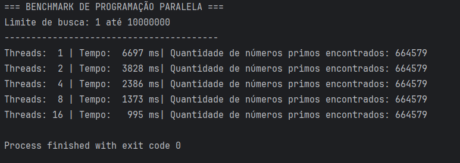
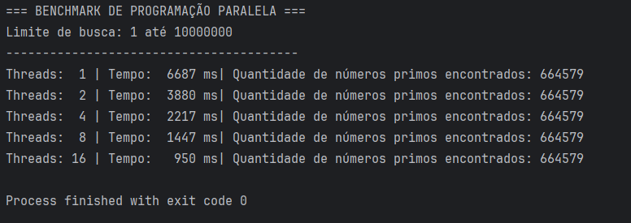
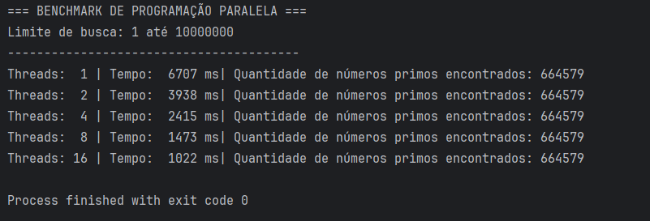
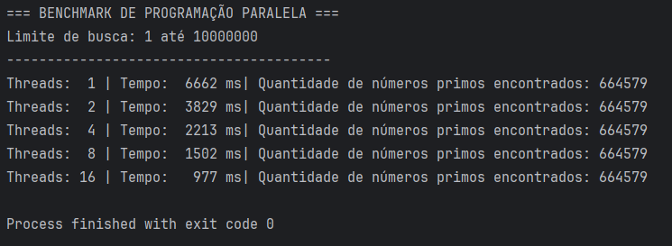
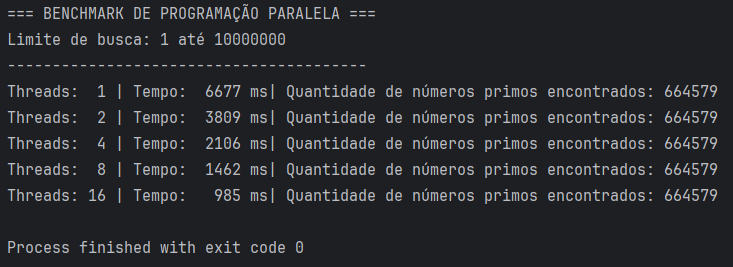
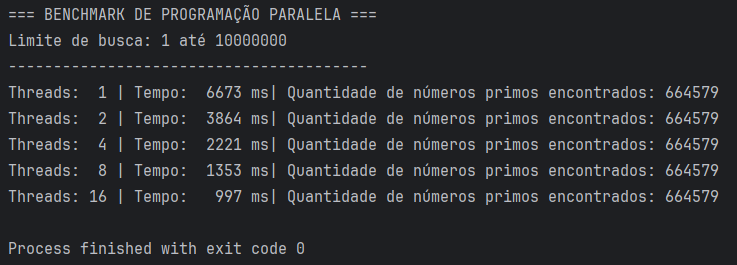
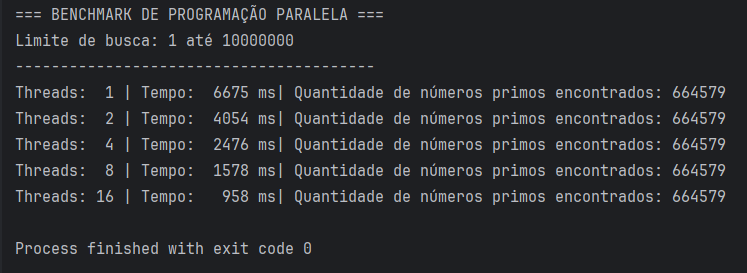
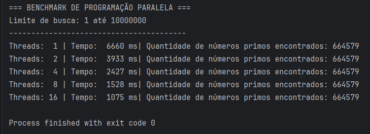
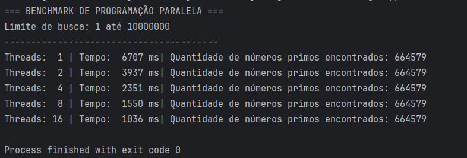
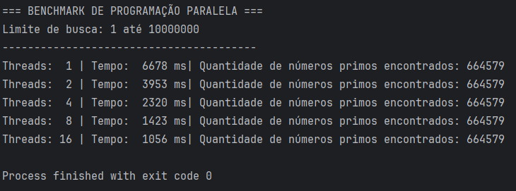

# Relatório — Contagem de números primos com threads

## 1. Identificação

- **Disciplina:** Programação Paralela
- **Professor(a):** Gustavo Henrique Araújo Barbosa
- **Dupla:** Tiago Elias Abrantes Silva e Gustavo Fontes Gadelha
- **Turma:** 2026.2
- **Data:** 21/11/2026

## 2. Ambiente de execução

- **Processador:** AMD Ryzen 7 7730U with Radeon Graphics
- **Memória RAM:** 8 GB DDR4
- **Sistema operacional:** Windows 11
- **Versão do Java:** Java 21

## 3. Resultados

### Primos encontrados

| Número de threads | Limite analisado | Primos encontrados |
|------------------:|-----------------:|-------------------:|
|                 1 |   `10_000_000L`  |             664579 |
|                 2 |   `10_000_000L`  |             664579 |
|                 4 |   `10_000_000L`  |             664579 |
|                 8 |   `10_000_000L`  |             664579 |
|                16 |   `10_000_000L`  |             664579 |

### Tempo das 10 execuções (ms)

| Número de threads | [1ª (ms)](#1ª-execução) | [2ª (ms)](#2ª-execução) | [3ª (ms)](#3ª-execução) | [4ª (ms)](#4ª-execução) | [5ª (ms)](#5ª-execução) | [6ª (ms)](#6ª-execução) | [7ª (ms)](#7ª-execução) | [8ª (ms)](#8ª-execução) | [9ª (ms)](#9ª-execução) | [10ª (ms)](#10ª-execução) | Média (ms) |
|------------------:|--------:|--------:|--------:|--------:|--------:|--------:|--------:|--------:|--------:|---------:|-----------:|
|                 1 |    6697 |    6687 |    6707 |    6662 |    6677 |    6673 |    6675 |    6660 |    6707 |     6678 |     6682,3 |
|                 2 |    3828 |    3880 |    3938 |    3829 |    3809 |    3864 |    4054 |    3933 |    3937 |     3953 |     3902,5 |
|                 4 |    2386 |    2217 |    2415 |    2213 |    2106 |    2221 |    2476 |    2427 |    2351 |     2320 |     2313,2 |
|                 8 |    1373 |    1447 |    1473 |    1502 |    1462 |    1353 |    1578 |    1528 |    1550 |     1423 |     1468,9 |
|                16 |     995 |     950 |    1022 |     977 |     985 |     997 |     958 |    1075 |    1036 |     1056 |     1005,1 |

## 4. Análise

### 1. A quantidade de primos encontrados foi igual em todas as configurações? Por que esse resultado é esperado?

> A quantidade de números primos encontrados foi a mesma para todas as configurações de threads porque foi usada a mesma amostragem. Independente da configuração usada, a quantidade de números primos existentes entre 1 e 10.000.000 é a mesma.

### 2. Qual configuração terminou mais rápido nas medições de vocês?

> 16 threads, com tempo médio de 1005 ms.

### 3. O tempo diminuiu sempre que o número de threads aumentou? Expliquem o que observaram.

> Sim, o tempo de execução diminuiu sempre que o número de threads aumentou, mas o ganho não foi proporcional. As médias foram: 6682,3 ms com 1 thread; 3902,5 ms com 2; 2313,2 ms com 4; 1468,9 ms com 8; e 1005,1 ms com 16.
>
> Se o ganho fosse proporcional, dobrar o número de threads reduziria o tempo pela metade (50% do anterior). Na prática, de 1 para 2 threads o tempo caiu para cerca de 58% do anterior, de 2 para 4 para 59%, de 4 para 8 para 63% e de 8 para 16 para 68%. Ou seja, a cada dobra o ganho foi menor. Com 16 threads, o tempo ficou em cerca de 15% do tempo com 1 thread, quando o ideal seria 6,25%. Além disso, a redução de tempo de 8 para 16 threads (463,8 ms em média) foi bem menor que a de 1 para 2 (2779,8 ms).
>
> Isso é esperado devido ao overhead de criação e sincronização das threads, à parte do programa que não pode ser paralelizada (Lei de Amdahl) e ao número limitado de núcleos do processador, que faz as threads disputarem o mesmo hardware.

### 4. O número de threads mais rápido foi igual ao número de núcleos do processador? Se souberem, comparem.

> Não. O processador tem 8 núcleos, mas a configuração mais rápida usou 16 threads, o dobro.

### 5. Por que adicionar threads pode deixar de melhorar o tempo ou até torná-lo maior?

> Criar, gerenciar, coordenar, comunicar e sincronizar threads exigem recursos adicionais que impactam diretamente o tempo de execução.

## 5. Conclusão

> Paralelismo é a capacidade de realizar várias tarefas simultaneamente utilizando recursos de processamento distintos, enquanto que Concorrência é a capacidade de realizar várias tarefas fazendo-as progredir alternadamente.
>
> No benchmark realizado, a melhor configuração utilizada foi a de 16 threads, com tempo médio de 1005 ms.

## 6. Evidências

### 1ª execução

### 2ª execução

### 3ª execução

### 4ª execução

### 5ª execução

### 6ª execução

### 7ª execução

### 8ª execução

### 9ª execução

### 10ª execução
